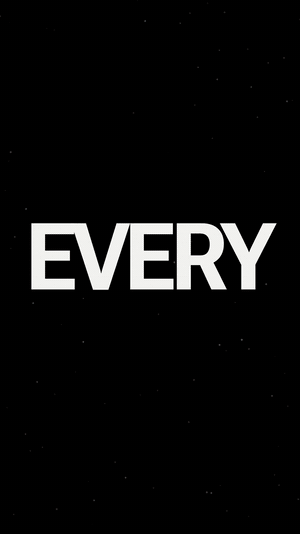

# beatfilm

Render HTML canvas animations to MP4, frame by frame, cut to the beat. No video editor.



This is the engine behind the promo films of the [Make Yourself](https://makeyourself.app) app. A film is one HTML page whose every frame is a pure function of time. Headless Chrome draws each frame, ffmpeg encodes them, and one cue sheet drives both the camera hits and the sound, so picture and audio cannot drift.

## Requirements

- Node 22 or newer (no npm packages)
- Chrome, Chromium or Edge
- ffmpeg on your `PATH`

Set `CHROME` or `FFMPEG` to a full path if they are somewhere else.

## Quick start

```bash
git clone https://github.com/MakeYourselfApp/beatfilm
cd beatfilm
npm run hello
```

That writes `out/hello.mp4` (1080x1920, 60 fps, 8 s, with sound). To just watch a film, open `examples/hello/film.html` in a browser: it loops in real time.

## How a film works

```html
<canvas id="c"></canvas>
<script src="../../engine/engine.js"></script>
<script>
const { text, ease, C } = BF;
Film({
  bpm: 120, beats: 16,
  draw(ctx, t, b) {            // t = seconds, b = beats
    text(ctx, 'HELLO', 540, 960, { size: 260, reveal: ease(b, 0, 1) });
  },
});
</script>
```

`draw` must depend only on `t` and `b`: no timers, no `Math.random()` (use `BF.rnd(i)`). That is what makes every frame reproducible.

The engine gives you easing (`ease`, `E`, `seg`, `lerp`), text with mask reveals, particles sampled from text or shapes (`textPoints`, `shapePoints`), film grain, vignette, glow, dust, shock rings, slice glitch, a HUD overlay, and a camera that reacts to a cue sheet (`cueFx`, `camera`). `warp` and `warpPts` refit an animation to a different song without re-animating it.

For another frame size, set `window.FILM_W` and `window.FILM_H` before loading `engine.js` and pass the same size to the capture as `CAP_W` and `CAP_H`.

## Tools

| Command | What it does |
| --- | --- |
| `node tools/capture.js <film.html> <out.mp4> <fps> [from] [to]` | Renders the film to a silent MP4. Add `--png <dir> <step>` to also save every Nth frame; use `-` as the output for stills only. |
| `node tools/sound.js <film-folder>` | Synthesises every cue in `<film-folder>/cues.js` into `audio.wav` (impacts, risers, whooshes, pops, drones and more, all generated, no samples). |
| `node tools/mux.js <video> <audio> <out.mp4> [fade]` | Puts audio on the render, cut to length, faded out, normalised to -14 LUFS. Works with your own song too. |
| `node tools/beats.js <audio> [bpm]` | Tempo, first beat and strongest hits of a track. |
| `node tools/onsets.js <audio> <bpm...>` | Strong onsets in order, and how well each tempo explains them. |
| `node tools/bands.js <audio>` | Hi-hat, mid and low hits with exact times, for cutting on every hit. |

## Cue sheets

`cues.js` is a list of events in beats:

```js
{ type: 'impact', b: 3, amp: 1, shake: 0.8, glitch: 0.7 },
{ type: 'riser', from: 6.5, b: 8, amp: 0.5 },
```

`tools/sound.js` turns each one into sound. In the film, `BF.cueFx(b, CUES)` turns the same list into zoom punches, shake and glitch.

## Licence

Code: [MIT](LICENSE). The bundled font, [Make Yourself Sans](https://github.com/MakeYourselfApp/make-yourself-sans), is under the [SIL Open Font License](engine/fonts/OFL.txt).
